<p align="center">
  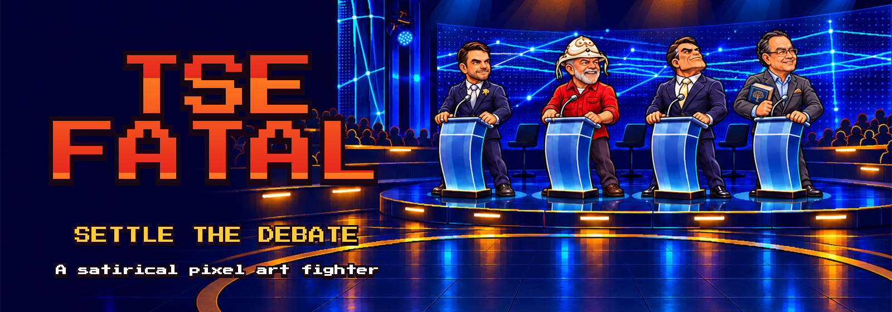
</p>

<h3 align="center">A Brazilian election debate, settled as a 2D platform fighter.</h3>

<p align="center">
  Pick a candidate, take the stage at the Planalto Palace, and knock your rival off the screen before they do it to you.
</p>

> [!NOTE]
> TSE Fatal is satire and fiction. The moves are jokes built on internet memes and stories that made the news; they are not accusations or statements of fact. No real voices, photos, or speeches are used. The game is in Brazilian Portuguese.

## How a match works

TSE Fatal plays like Brawlhalla with an arcade coat of paint.

- **Damage is a percentage.** There is no health bar. The higher your damage, the farther each hit sends you flying.
- **Three lives each.** Fly off the screen and the game stamps you *CASSADO!* (impeached).
- **Win the election.** Take all three of your rival's lives and you are *ELEITO!* (elected).
- **One player against a bot,** with easy, normal, and hard difficulty. A demo mode runs bot against bot nonstop.

<p align="center">
  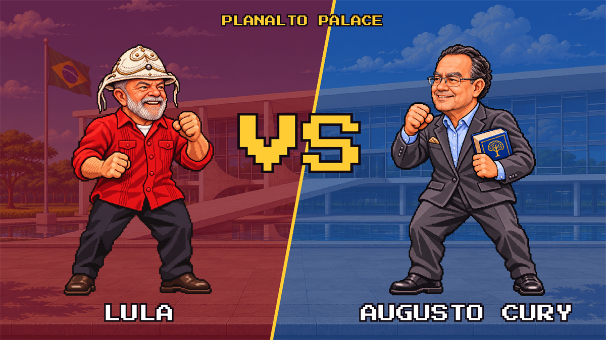
</p>

## Candidates

<p align="center">
  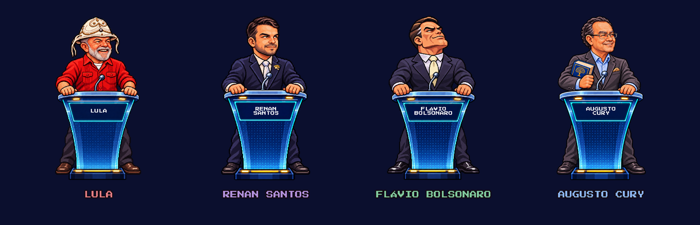
</p>

Each candidate has their own stats and three abilities on **K**, **L**, and **I**. Ability names are Brazilian political memes, so they stay in Portuguese.

| | Candidate | Plays like | K | L | I |
| :---: | --- | --- | --- | --- | --- |
| 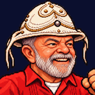 | **Lula** | Heavyweight, hard to launch | Mensalão | Faz o L | Censura |
|  | **Renan Santos** | Fastest, light on his feet | Corte Viral | Onça Liberal | Fralda do Debate |
| 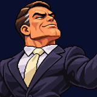 | **Flávio Bolsonaro** | Balanced, heals himself | Rachadinha | Mansão de 6 Milhões | Chocolate Lavado |
|  | **Augusto Cury** | Control, fights from range | Drone com Sirene | Ministério da IA | Palestra Motivacional |

<details>
<summary><b>What each ability does</b></summary>
<br>

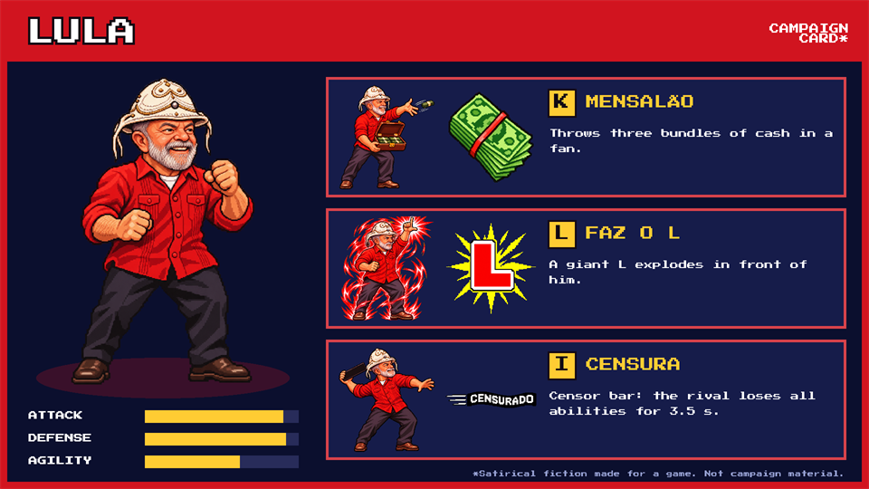

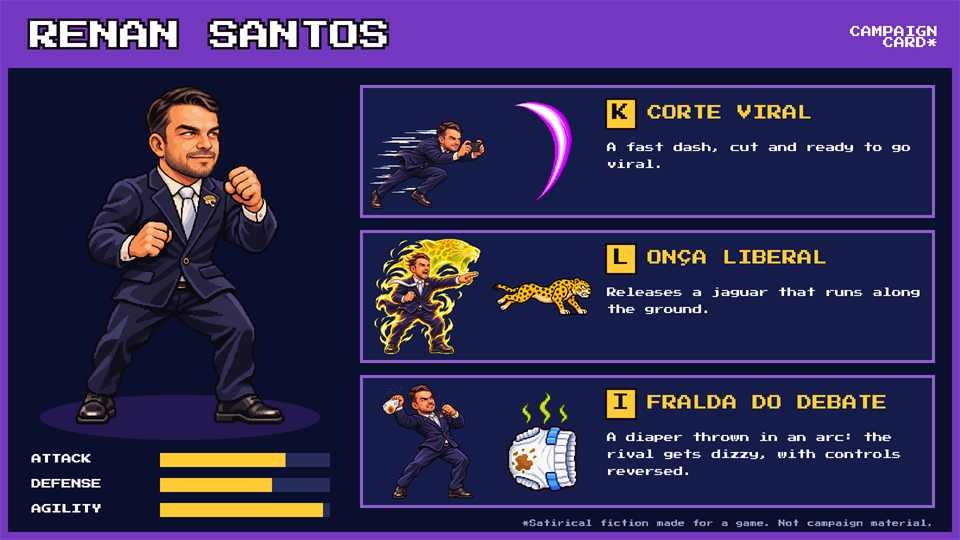

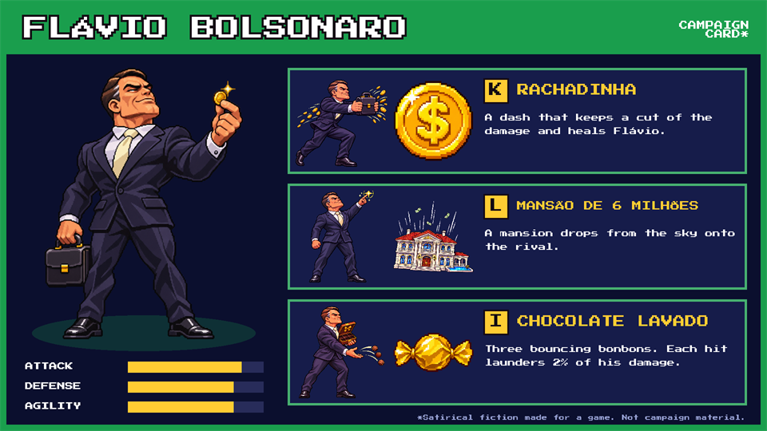

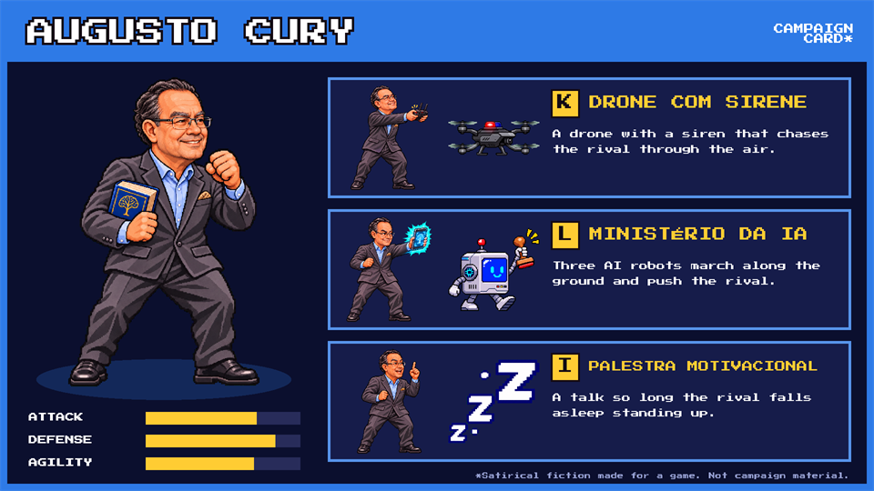

</details>

## Controls

| Key | Action |
| --- | --- |
| `A` `D` | Move |
| `W` or `Space` | Jump, twice in the air |
| `S` | Drop through a platform, fast fall |
| `Shift` | Dodge. Also breaks out of light hits after a moment |
| `J` | Punch: a three-hit combo on the ground, a kick in the air |
| `K` `L` `I` | Abilities |
| `Esc` | Back to the menu |

In menus, `W` `S` or the arrow keys move the cursor, `A` `D` switch candidates, and `Enter` confirms.

## On the campaign trail

<p align="center">
  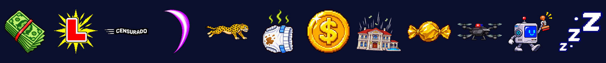
</p>

- **Picanha** (Brazilian barbecue) drops onto a platform every so often. Grab it to heal 15% of your damage.
- **Knockout banners** are drawn at random: *CASSADO!*, *INELEGÍVEL!*, *IMPEACHMENT!*, *DELATADO!*, *CPI NELE!*
- **Each candidate talks** when they lose a life, come back, and win.
- **Voice acting is optional.** Record the lines and drop the files in a folder; the game plays them and lowers the music. The script is in [`Docs/DUBLAGEM.md`](Docs/DUBLAGEM.md).
- **Music and sound effects** are synthesized in code. The project has no audio files.

## Run the project

1. Install Unity **6000.6.8f1** from Unity Hub and open this folder.
2. Wait for the first import. It brings in UGUI, 2D Pixel Perfect, and about 265 art files.
3. Open `Assets/Scenes/Main` and press **Play**.

The scene is nearly empty on purpose. Menus, the arena, the HUD, and the fighters are built in code at startup.

## Project layout

```
Assets/
  Scenes/Main.unity            single entry scene
  Scripts/                     the whole game, namespace TSEFatal
    GameFlow.cs                menu, character select, versus, fight
    FighterController.cs       movement, attacks, abilities, bot AI
    CharacterProfile.cs        each candidate's stats, abilities, and lines
    ...                        arena, projectiles, effects, HUD, audio
  Editor/                      automatic pixel art import settings
  Resources/
    Art/Characters/            base image + one file per frame: {id}/{state}/01.png
    Art/VFX/                   ability effect frames: {effect}/01.png
    Art/Menu/                  menu backgrounds and podiums
    Art/Stages/                the Planalto Palace
    Fonts/                     Press Start 2P
Docs/                          design notes, art guide, voice script, README images
PromptsAnimacao/               one image-generation prompt per frame
```

## How the art is made

Every frame is generated one at a time from its own prompt in [`PromptsAnimacao/`](PromptsAnimacao/README.md). Each prompt attaches the candidate's base image and the previous frame, so the character stays consistent across all 47 frames.

The image generator returns frames on a solid green background, or magenta when the drawing itself has green in it. The game removes that background when it loads the frame.

<p align="center">
  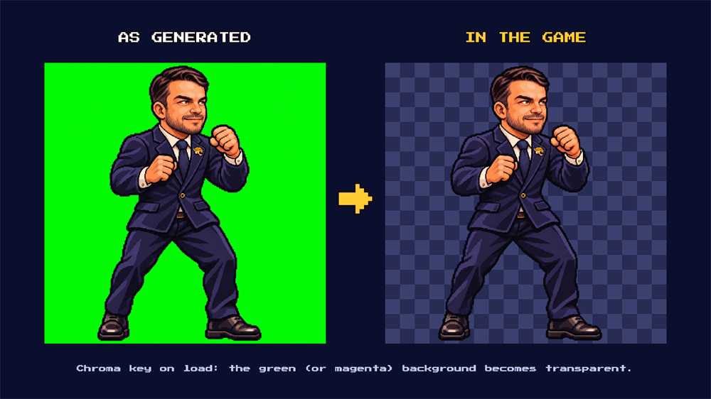
</p>

To add a new candidate:

1. Fill in their profile in `CharacterProfile.cs`.
2. Write their three abilities in `FighterController.cs`.
3. Save their frames under `Assets/Resources/Art/Characters/{id}/`.

More detail, in Portuguese: [`Docs/GAME_DESIGN.md`](Docs/GAME_DESIGN.md), [`Docs/ART_PACK.md`](Docs/ART_PACK.md), and [`Docs/ANIMATION_PROMPTS.md`](Docs/ANIMATION_PROMPTS.md).

## License

All rights reserved. TSE Fatal's code, art, text, and audio are **not** open source. You may read this repository and run the game locally for personal or academic use. You may not redistribute it, sell it, publish it on any store, or reuse its material in other projects. See [`LICENSE`](LICENSE) for the full terms.

The Press Start 2P font is third-party work under the SIL Open Font License 1.1 ([`Assets/Resources/Fonts/OFL.txt`](Assets/Resources/Fonts/OFL.txt)).

<br>

<p align="center">
  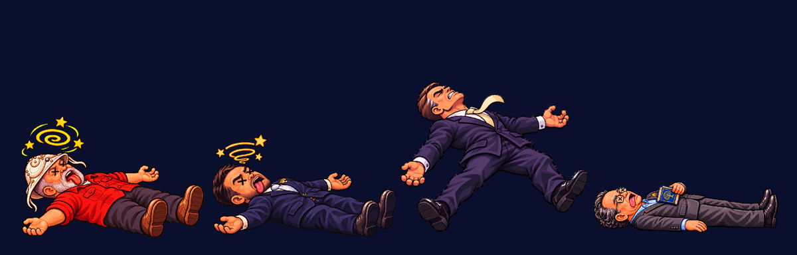
  <br>
  <sub>Polls are closed. No recount.</sub>
</p>
